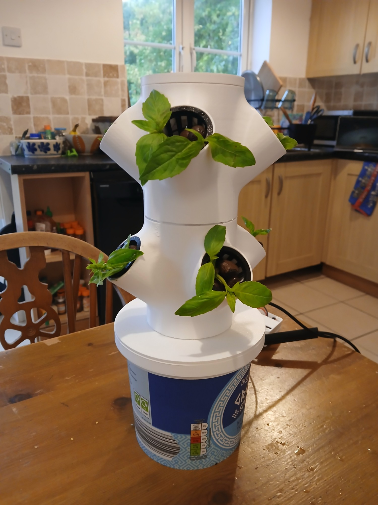
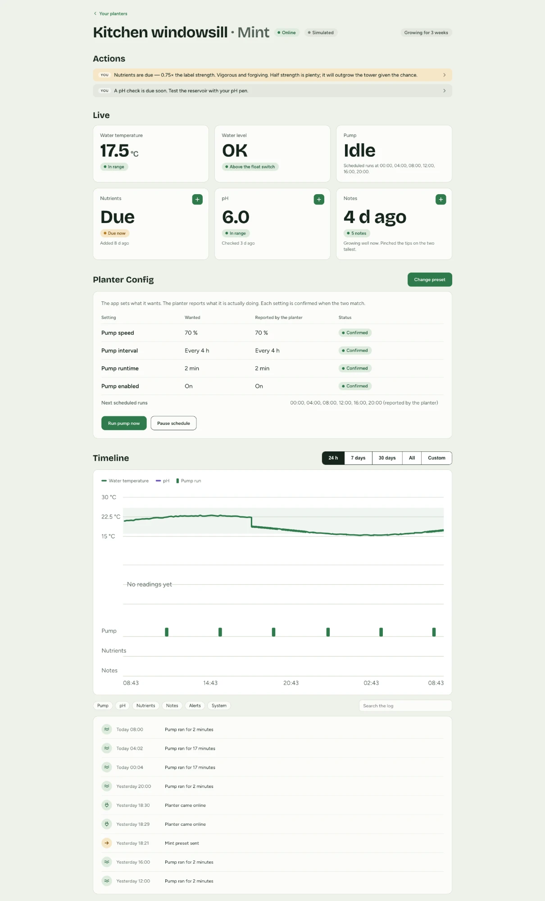

# Smart Planter

A hydroponic herb tower that waters itself, monitors water
temperature and level, and reports to a web app you run on your own machine.



Built around an **ESP32-C3** running [ESPHome](https://esphome.io), talking
**MQTT** to a local backend, with a React dashboard on top.

---

## What it does

- **Waters on a schedule it keeps itself.** The board holds the interval and
  runtime in flash, so the tower keeps working with the app closed, the laptop
  shut and the Wi-Fi down.
- **Refuses to run dry.** A float switch is checked before
  every run, and prevents the pump from running if the water is too low.
- **Tracks what you can't see.** Water temperature, water level, pH check-ins,
  nutrient doses and free-text notes, all on one timeline.
- **Tells you what needs doing.** Alerts are derived from current state rather
  than stored, so they can't go stale.

For what the firmware is doing, see [firmware/README.md](firmware/README.md).
The MQTT contract between board and app lives in one file,
[`packages/shared/src/topics.ts`](packages/shared/src/topics.ts).

---

## Build it

The hardware sections below are the physical build. The software sections after
them apply once you have a board to talk to.

### 1. Parts list

The tower is based on [Mini Hydroponic Herb Tower by Pascal](https://makerworld.com/en/models/1388075-mini-hydroponic-herb-garden-battery-or-usb-powered)
on MakerWorld — credit to the original designer. Check the model's licence
before redistributing modified files.

If you include the float switch from the parts list, you will need to increase
the height of the reservoir or use a separate container inside it — an empty
yoghurt pot works well.

It is a hydroponic (soil-free) tower: a small reservoir pumps water up through
the centre to wet the roots of plants sitting in net pots along the sides.

**For printing**

- White PETG filament, roughly 1/3 spool for the tank and tower tiers.
- Black PLA for the netted pots
- A printer with at least a ~22 × 20 cm build volume for a tier. This build used
  a Bambu Lab A1.

**Electronics**

| Part                                                  | Link                                                  |
| ----------------------------------------------------- | ----------------------------------------------------- |
| ESP32-C3 Super Mini                                   | https://www.amazon.co.uk/dp/B0DMN6VKNN                |
| Dual H-bridge motor driver (MX1508-type)              | https://www.aliexpress.com/item/1005006208997376.html |
| 3–5 V submersible mini pump                           | https://www.aliexpress.com/item/1005007401287244.html |
| Silicone tubing, 6 mm ID / 8 mm OD                    | https://www.aliexpress.com/item/1005007401287244.html |
| Stainless vertical float switch (~45 mm)              | https://www.aliexpress.com/item/32924981269.html      |
| DS18B20 waterproof temperature probe                  | https://www.amazon.co.uk/dp/B01MY9QR49                |
| 4.7 kΩ resistor                                       | https://www.amazon.co.uk/dp/B07YCPR6K7                |
| 22AWG silicone-insulated hookup wire, several colours | https://www.amazon.co.uk/dp/B09BFPHRZ6                |
| Heat-shrink tubing, assorted sizes                    | https://www.amazon.co.uk/dp/B0F4K3L8CG                |

**Growing**

| Item                                  | Link                                   |
| ------------------------------------- | -------------------------------------- |
| Clay pebbles (LECA)                   | https://www.amazon.co.uk/dp/B0CZ13T1RM |
| pH pen                                | https://www.amazon.co.uk/dp/B0BG6TVBYB |
| One-part hydroponic nutrient solution | Garden store                           |
| Young herb plants                     | Garden store or supermarket            |

**Tools**

| Item                      | Link                                   |
| ------------------------- | -------------------------------------- |
| Soldering iron and solder | https://www.amazon.co.uk/dp/B09C7TMQGX |
| Stand / helping-hands     | https://www.amazon.co.uk/dp/B0724ZNNGW |
| Wire strippers            | https://www.amazon.co.uk/dp/B0FNC5ZRX7 |
| Wire cutters              | https://www.amazon.co.uk/dp/B07GCLHSTF |
| Multimeter                | https://www.amazon.co.uk/dp/B01ISAMUA6 |
| Heat gun                  | https://www.amazon.co.uk/dp/B0GF7ZVRS6 |

### 2. 3D printing

1. Print the reservoir and tower tiers in PETG
2. Print the netted pots in PLA
3. **Check the float switch clearance before you print the tank.** If the
   reservoir needs to be deeper than the base design to let the float move
   freely, modify the height before printing.

### 3. Electronics

This build is fully direct-wired — no perfboard, no breadboard, and no
capacitors beyond what is already on the driver board.

The pin assignments below are what the firmware actually uses. If you change
them, change `firmware/esphome.yaml` to match.

| Pin      | Connects to          | Notes                                              |
| -------- | -------------------- | -------------------------------------------------- |
| `GPIO05` | DS18B20 data         | One-wire bus, needs a 4.7 kΩ pull-up to 3V3        |
| `GPIO10` | Float switch         | Other leg to **ground**. Uses the internal pull-up |
| `GPIO04` | Motor driver input A | PWM at 1000 Hz                                     |
| `GPIO03` | Motor driver input B | PWM at 1000 Hz                                     |

**Avoid GPIO2, GPIO8 and GPIO9.** They are strapping pins on the ESP32-C3, used
during boot, and anything attached to them changes how the chip starts.

#### Wiring

1. **Driver.** Connect the driver's power input (+/−) to the ESP32's 5V and GND.
   Connect two of the driver's input pins — either IN1/IN2 or IN3/IN4, either
   pair works — to GPIO3 and GPIO4.
2. **Pump.** Connect the pump's two wires to whichever **output** pair matches
   the input pair you used: Motor-A output for IN1/IN2, Motor-B for IN3/IN4.
   This matters. Wire the pump to the wrong output and the firmware will
   correctly drive a channel with nothing attached, and the pump will simply
   never run.
3. **Float switch.** Connect its two wires to GPIO10 and a ground pin. It has no
   polarity, so either wire can go to either pin.
4. **Temperature probe.** Red to 3V3, black to ground, yellow (data) to GPIO5.
   Solder the 4.7 kΩ resistor as a bridge between the data wire and the power
   wire — this is the pull-up the one-wire protocol needs. It does not connect
   to any additional pin on the board.
5. Multiple wires can share a single ground point. That is normal and fine; just
   make sure the joint stays solid as you add more wires to it.

**Check your pump direction before you trust the pin order.** On this build the
motor leads were connected the other way round at the driver, so the obvious
mapping drove the pump backwards: it hummed loudly and moved no water. `GPIO04`
and `GPIO03` are deliberately swapped in the firmware to compensate. See
[Troubleshooting](#the-pump-hums-but-no-water-moves).

#### A note on the float switch

This type of switch only works mounted **vertically**, hanging freely, so
gravity and buoyancy can move the float sleeve along its shaft. Before you
finalise the design:

1. **Test the switch's actual travel** in a tall glass of water with a multimeter
   in continuity mode, rather than assuming it from the dry, fully-extended
   length.
2. **Confirm your reservoir's depth accommodates that travel.**
3. **Confirm which position closes the switch — don't assume.** This build
   found **water present → switch open**, **water low → switch closed**, which
   is what the firmware expects: the pin is _not_ inverted, so an open switch
   lets the internal pull-up read HIGH and ESPHome publishes that as "Water OK".

If yours measures the other way round, change the firmware to match. A backwards
float switch blocks a full tank and permits a dry one, and it looks exactly like
working code.

#### Test as you go

Test each component in isolation before moving to the next, and again after
combining them:

1. **Bench-test the pump** on its own, submerged in a cup of water. Never run
   these pumps dry.
2. **Bench-test the float switch** by hand with the multimeter in continuity
   mode, moving the float, before it is wired into any firmware logic.
3. **Bench-test the probe's wiring** with the multimeter: the data line should
   read close to 3.3 V, confirming the pull-up is working, before firmware can
   read an actual temperature.
4. Only once each part works alone, wire them together and retest as a group.
   Check for accidental shorts between wires that shouldn't be connected, not
   just that each intended connection works.

### 4. Assembly

1. Test everything on the bench, fully wired, before anything goes near the
   printed case.
2. Connect the pump's outlet to the silicone tubing and route it through the
   tower, checking for kinks.
3. Run the pump wet, submerged, with the tubing attached, and confirm water
   flows all the way through before sealing anything. A kinked or blocked tube
   is far easier to fix now than after assembly.
4. Add clay pebbles to the net pots and add your plants.

---

### 5. Flash the firmware

You need Python 3.11+ and ESPHome:

```bash
pipx install esphome
```

Fill in your Wi-Fi and broker details:

```bash
cp firmware/secrets.yaml.example firmware/secrets.yaml
```

`secrets.yaml` is gitignored. Three things to get right:

- **`wifi_ssid` / `wifi_password`** — the network the tower joins. The ESP32-C3
  is **2.4 GHz only**; it cannot see a 5 GHz network at all. These are compiled
  in, so changing networks later means reflashing.
- **`mqtt_host`** — where the board looks for the broker, which is the machine
  running the backend. Prefer an mDNS name over an IP, because most networks
  hand out a new address on reconnect. On macOS, `scutil --get LocalHostName`
  then append `.local`.
- **`ap_password`** — the fallback access point the board raises when it can't
  reach your network. **Change it from the default** before flashing anything
  that leaves your desk.

Set the planter's identity in `firmware/esphome.yaml` — this becomes its MQTT
topic prefix and its name to the app. Give each planter its own:

```yaml
substitutions:
  planter_id: planter-001
```

Then plug the board in over USB-C and flash it:

```bash
esphome run firmware/esphome.yaml
```

**If the board isn't detected,** hold its **BOOT** button while plugging the
cable in, then release after a second or two. Many compact ESP32-C3 boards lack
the automatic reset circuitry larger dev boards have, so entering flashing mode
has to be done by hand. Check too that your cable carries data — a charge-only
USB-C cable fails silently here.

**Watch the log after flashing.** Confirm the board joins your Wi-Fi, and that
the Dallas component reports a _found device_ rather than an empty list. An
empty list means the temperature probe or its pull-up resistor is not wired as
the config expects.

After the first flash, subsequent updates can go over the air — the board stays
on your network and `esphome run` finds it by mDNS.

### 6. Run the software

Requires **Node 22.22.2** (pinned in `.nvmrc`) and **pnpm 12** via corepack.

```bash
nvm use && corepack enable && pnpm install
```

```bash
pnpm dev
```

That starts three processes — the embedded MQTT broker, the backend and the web
app. Open <http://localhost:5173>.

Nothing else needs installing; the broker is embedded. If you'd rather run real
Mosquitto (useful for `mosquitto_sub` debugging) see `infra/mosquitto.conf`.

From a phone on the same network, use the Network address Vite prints. The API
is proxied through the same port, so that one address is all the phone needs.

Each planter needs its own `planter_id`. Two boards publishing under one id
fight over the same topics, so give each one a distinct value in its firmware
before flashing.

### 7. Add your planter



Power the board on, on the same network as the machine running the backend. It
publishes to MQTT on boot, the backend discovers it automatically, and it shows
up under **Add planter** within a few seconds.

Discovered planters stay **off** the dashboard until you add one deliberately —
that's what keeps the fleet empty until you onboard something. Pick it, give it
a name and a preset, and it appears on the dashboard.

Presets set the watering frequency, the target pH and temperature bands, and how
often to feed. Every preset waters for 2 minutes at 70%; only the number of runs
per day changes. See `packages/shared/src/presets.ts`.

---

## Troubleshooting

### `Could not open /dev/cu.usbmodem…, the port is busy`

Something else is holding the serial port. The usual culprit is a browser tab
left open on web.esphome.io, which keeps the port claimed even when idle.

```bash
lsof /dev/cu.usbmodem101
```

Close whatever owns it rather than killing the process.

### Flashing dies part-way through with `Invalid head of packet`

A board stuck in a boot loop keeps interrupting the flashing stub. Hold the
**BOOT** button while plugging it in to force download mode, then flash without
the stub:

```bash
esptool.py --port /dev/cu.usbmodem101 --no-stub erase_flash
```

Then flash normally.

### The pump hums but no water moves

The pump is running backwards. The motor leads are reversed at the driver
relative to what the firmware assumes. Either swap the two motor wires at the
driver, or swap `motor_forward_pin` and `motor_reverse_pin` in the `output:`
block of `firmware/esphome.yaml` and reflash.

You can confirm which it is before changing anything by publishing `reverse` to
`<planter_id>/fan/pump/direction/command` while the pump is running.

### The pump won't start at all

The interlock is refusing it. Both of these must be true:

- **Pump Enable** is on (Config section in the app, or the board's own web UI).
- **Water OK** reads OK — the float is up and has been for five continuous
  seconds.

The device log says exactly which one failed:

```
INTERLOCK: run refused (pump disabled or low water)
```

If the tank is full but Water OK reads low, your float switch polarity is
backwards. See [Electronics](#3-electronics).

### The board never appears in the app

Work down the chain:

1. **Is it on the network?** The ESP32-C3 is 2.4 GHz only. Check the hotspot or
   router isn't 5 GHz or band-steering.
2. **Is the SSID still the one you flashed?** Credentials are compiled in.
   Changing network means reflashing.
3. **Can it find the broker?** A stale `mqtt_host` shows up only as
   `select() timeout` in the device log, with nothing pointing at the real
   cause. Verify the name still resolves.
4. **Is the backend running and subscribed?**

```bash
mosquitto_sub -h localhost -v -t '#'
```

If the board's messages appear there but not in the app, the problem is the
backend. If they don't appear at all, it's the board or the network.

### The board reboots every 15 minutes

ESPHome's native `api:` component reboots the device when no API client connects
for 15 minutes, and nothing connects to it here because the app speaks MQTT.
This config leaves `api:` out deliberately — if you've added it back, that's why.

### A deleted planter keeps coming back

MQTT retains the last message on each topic, so the broker will keep telling the
backend about a planter long after the device and the database row are gone.
Clear the retained messages by publishing an empty retained payload to each
topic:

```bash
mosquitto_pub -h localhost -r -n -t 'planter-00X/status'
```

Those clearing messages will themselves recreate the record, because an empty
message on a topic is still a message — so restart the backend afterwards.

### A pump run shows an absurd duration

A run of several thousand minutes means the board lost power mid-run and never
got to publish "pump off", so the retained ON sat there until the next boot
closed it. Current firmware closes the run at the last moment the backend heard
from the device and marks it interrupted. If you're seeing fresh ones, the board
is losing power mid-run.

### `crypto.hash is not a function`, or tests segfault

You're on the wrong Node version. The repo needs 22.22.2:

```bash
nvm use
```

If it keeps happening in new terminals, your nvm default is older:

```bash
nvm alias default 22.22.2
```

### Readings stop but the planter still shows online

The backend treats a device as online until the broker publishes its Last Will.
If the board browned out without a clean disconnect, that can lag. Check
`last seen` rather than the online chip.

---

## Customising

### Presets

Built-in presets live in `packages/shared/src/presets.ts`. Each sets a watering
frequency, target pH and water temperature bands, a feeding interval and a
nutrient type. Safety bounds in `packages/shared/src/preset.ts` clamp anything
out of range, so a bad preset can't ask the pump for something harmful.

### Feature flags

`packages/web/.env`:

```
VITE_AI_PRESETS=true
```

The AI preset builder is paused, so its entry points are hidden. Flip this on
when the screen exists.

---

## Developer reference

### Commands

```bash
pnpm dev         # broker + backend + web
pnpm test        # vitest across the workspace
pnpm typecheck   # tsc --noEmit across the workspace

pnpm dev:broker  # or run them individually in separate terminals
pnpm dev:backend
pnpm dev:web
```

Useful env vars: `MQTT_URL`, `MQTT_PORT`, `DB_PATH`, `PORT`, `HOST`.

### Packages

| Package            | What's in it                                                              |
| ------------------ | ------------------------------------------------------------------------- |
| `@planter/shared`  | Topics, preset schema + safety bounds, pH engine, alerts, flow, nutrients |
| `@planter/backend` | MQTT ingest, embedded broker, SQLite, SSE, REST API                       |
| `@planter/web`     | React app                                                                 |

`shared` is consumed straight from TypeScript source (`exports` points at
`src/index.ts`), so there is no build step — tsx, Vite and Vitest all transpile
it. Type safety comes from `pnpm typecheck`.

### Where your data lives

A SQLite file at `data/planter.db` (gitignored). It holds configuration,
readings, pH check-ins and events, and survives restarts. Sensor readings are
throttled to one row per metric per 10 seconds and pruned to 30 days on startup;
pH check-ins and events are never pruned.

Live device state is held by the broker as retained messages, not in SQLite, so
restarting the broker clears it until each device republishes.

Keep `planter.db`, `planter.db-wal` and `planter.db-shm` together. The `-wal`
file can be larger than the database and looks disposable — it isn't, it holds
committed transactions.

### Provisioning

```bash
pnpm provision --id planter-002 --name "Shelf 2"   # create the row ahead of time
pnpm provision --unadd planter-002                 # back to the Add planter list
pnpm provision --list
```

Mostly optional. The backend discovers any device that publishes to MQTT and
creates the row itself, so this is for naming a planter before it first
connects, taking one off the dashboard without deleting its history, or just
seeing what the database holds.

## Credits

Base tower design: [Pascal on MakerWorld](https://makerworld.com/en/models/1388075-mini-hydroponic-herb-garden-battery-or-usb-powered).
Firmware built with [ESPHome](https://esphome.io). Built and documented by Zoe,
with AI assistance throughout the design, debugging and documentation.
